# Sistema de Gestión y Control de Acceso de Empleados

Backend con API REST para administrar empleados, credenciales y puntos de acceso, y para registrar y consultar las entradas y salidas de los empleados de una empresa de servicios logísticos y de almacenamiento.

## Estructura de la solución

```
Microservices/Access/
├── Access.slnx
├── ef.cmd                    Script para crear y aplicar migraciones
├── Access.Domain/            Entidades, objetos de valor y reglas del negocio (sin dependencias)
├── Access.Application/       Casos de uso (CQRS), contratos de repositorios, mediador y validaciones
├── Access.Persistence/       DataContext, configuraciones de EF Core, repositorios, seeders y migraciones
├── Access.Api/               Controladores REST, DTOs y formato de respuesta
└── Access.Tests/             Pruebas unitarias del dominio
docs/
└── S2PDColeccion.postman_collection.json   Colección de Postman con las pruebas de la API
```

Las dependencias van hacia el dominio: `Api → Application ← Persistence`, y `Application → Domain`.

### Dominio (DDD)

| Entidad | Objetos de valor | Reglas principales |
|---|---|---|
| `Employee` | `DocumentNumber`, `Email`, `EmploymentStatus` | Identificación única que no cambia, correo único, no se modifica un empleado inactivo, se desactiva en lugar de eliminarse |
| `Area` | — | Área organizacional del empleado |
| `Credential` | `CredentialStatus` | Código único; solo una credencial vigente (`Active`) puede usarse; se puede bloquear (si está vigente) y revocar (definitivo) |
| `AccessPoint` | `AccessPointType` | Recepción, parqueadero, bodega o área restringida; puede estar habilitado o no |
| `AccessLog` | `MovementType`, `AccessResult` | Registro de cada intento de entrada o salida, autorizado o rechazado con su motivo |

### Casos de uso (CQRS)

Cada caso de uso tiene su comando o consulta, su validador y su manejador, y se ejecuta a través del mediador (`IMediator`):

- **Comandos:** `CreateEmployee`, `UpdateEmployee`, `DeactivateEmployee`, `AssignCredential`, `BlockCredential`, `RevokeCredential`, `CreateAccessPoint`, `RegisterAccess`.
- **Consultas:** `GetEmployeeById`, `GetEmployeesList`, `GetCredentialByCode`, `GetAccessPointById`, `GetAccessPointsList`, `GetAccessHistory`.

## Endpoints

| Requerimiento | Método | Ruta | Descripción |
|---|---|---|---|
| POST | `/api/employees` | Registrar empleado |
| GET | `/api/employees?pageNumber=1&pageSize=15` | Consultar empleados (paginado) |
| GET | `/api/employees/{id}` | Consultar un empleado |
| PUT | `/api/employees` | Actualizar empleado |
| PATCH | `/api/employees/{id}/deactivate` | Desactivar empleado |
| POST | `/api/credentials` | Asignar credencial a un empleado activo |
| GET | `/api/credentials/{code}` | Consultar el estado de una credencial |
| PATCH | `/api/credentials/{code}/block` | Bloquear credencial |
| PATCH | `/api/credentials/{code}/revoke` | Revocar credencial |
| POST | `/api/access` | Registrar entrada o salida |
| GET | `/api/access/history` | Consultar el historial de accesos |
| POST | `/api/access-points` | Registrar punto de acceso |
| GET | `/api/access-points?isEnabled=true` | Consultar puntos de acceso (filtro opcional de habilitados) |
| GET | `/api/access-points/{id}` | Consultar un punto de acceso |


| Código | Cuándo |
|---|---|
| 200 | Consulta o modificación exitosa |
| 201 | Registro creado (incluye los accesos rechazados, que también se registran) |
| 400 | Datos inválidos o regla de negocio incumplida (el detalle va en `errors`) |
| 404 | El recurso no existe |


## Evidencias

Capturas del funcionamiento de la API y de las pruebas, ubicadas en `docs/evidencias/`.

### Ejecución completa de la colección de Postman

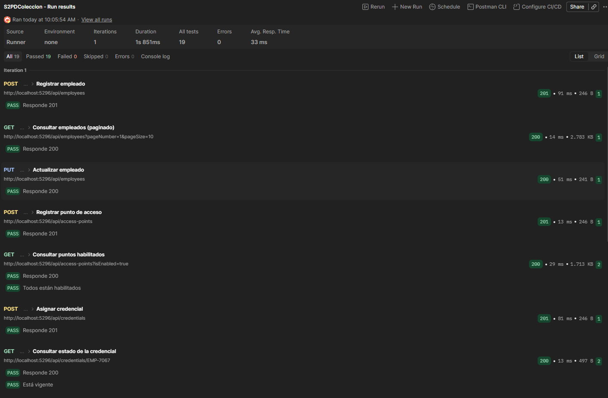

### RF-01: Gestión de empleados

| Registrar | Consultar |
|---|---|
| 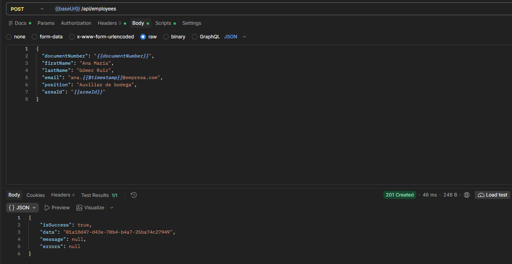 | 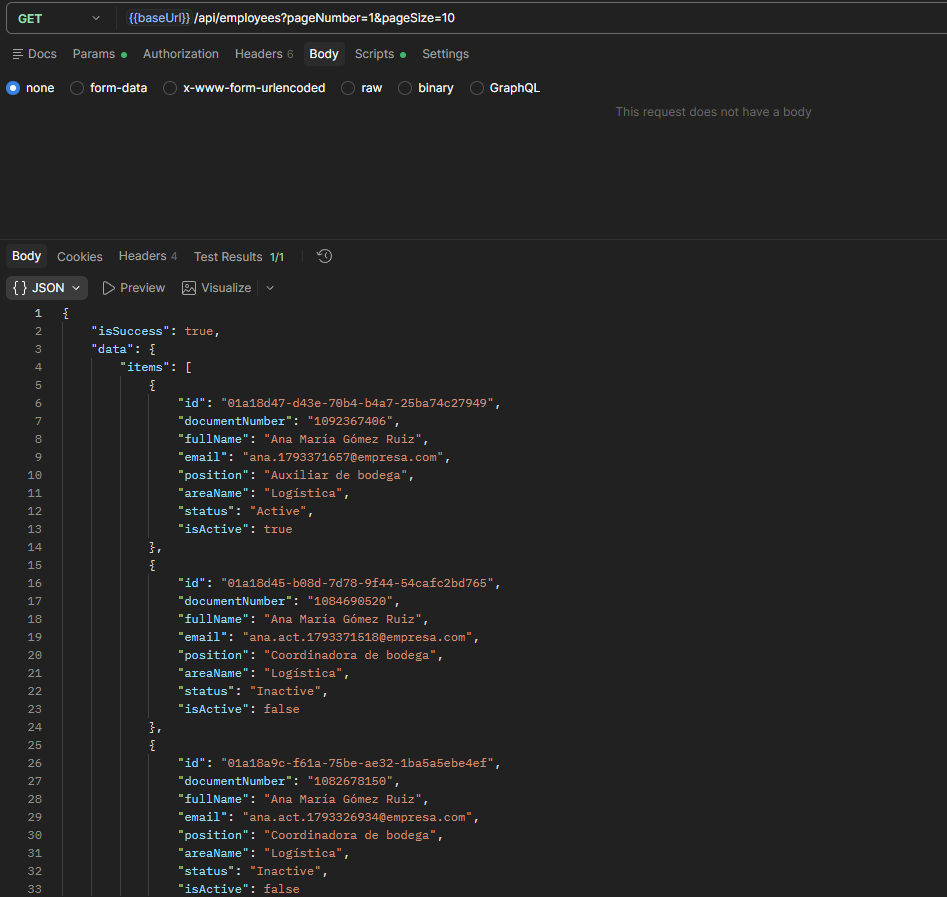 |

| Actualizar | Desactivar |
|---|---|
| 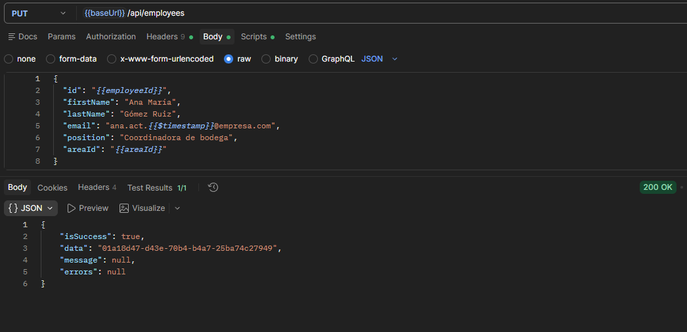 | 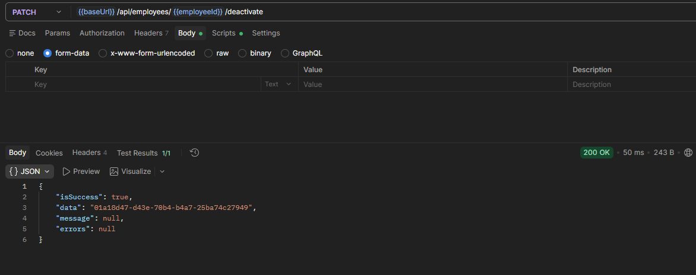 |

### RF-02: Gestión de credenciales

| Asignar | Consultar estado | Bloquear y revocar |
|---|---|---|
| 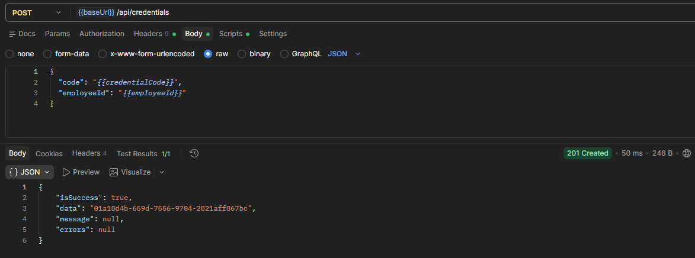 | 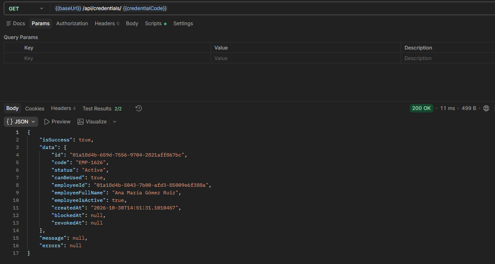 | 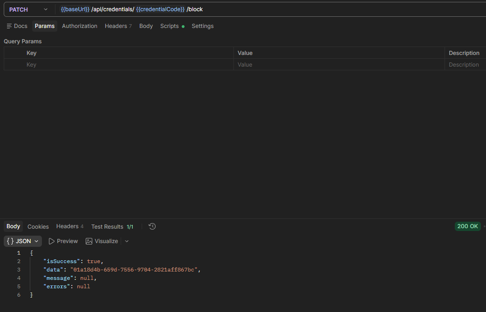 |

### RF-03: Registro de entradas y salidas

| Acceso autorizado | Acceso rechazado |
|---|---|
| 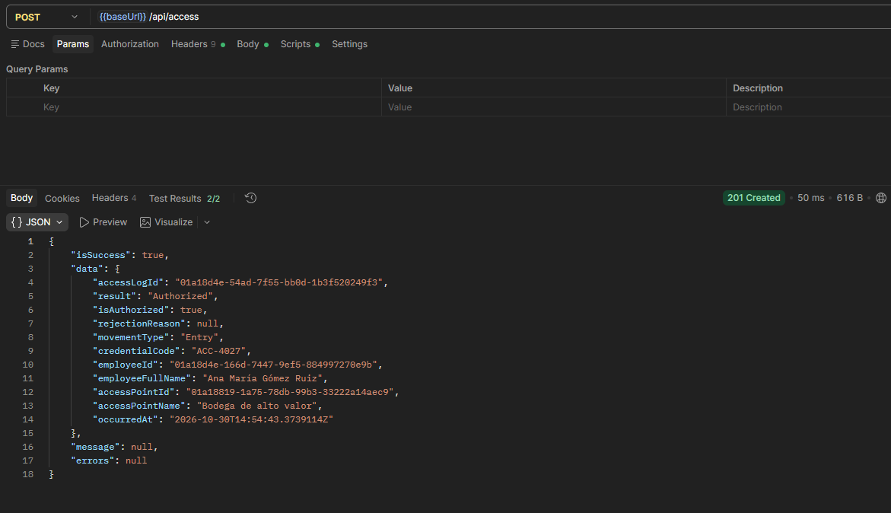 | 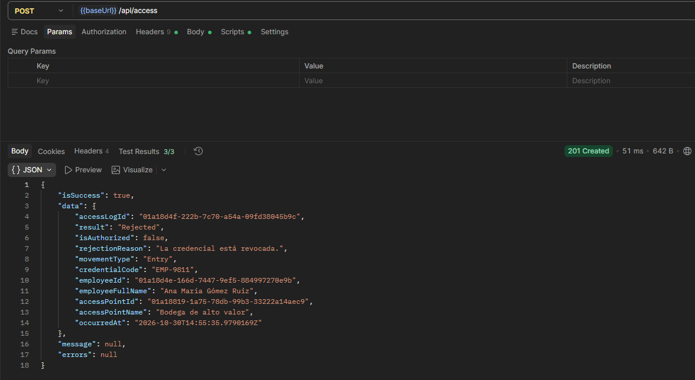 |

### RF-04: Historial de accesos

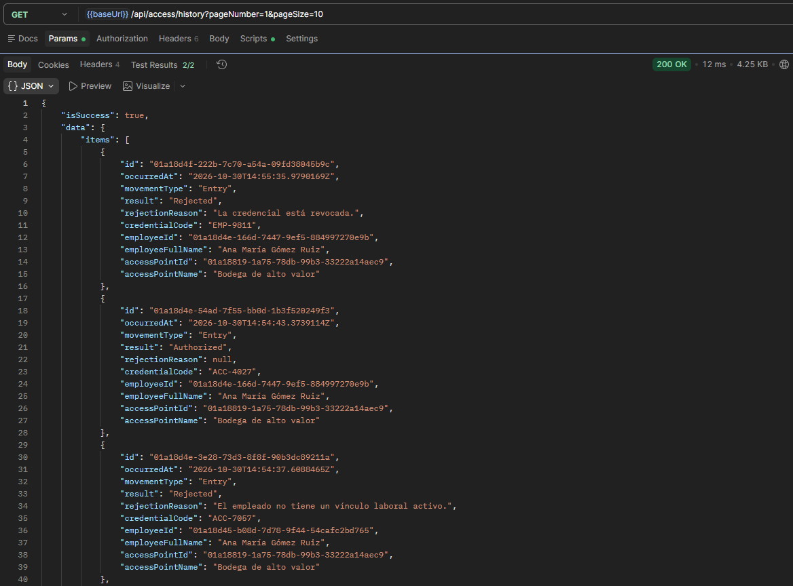

### RF-06: Puntos de acceso

| Registrar | Consultar habilitados |
|---|---|
| 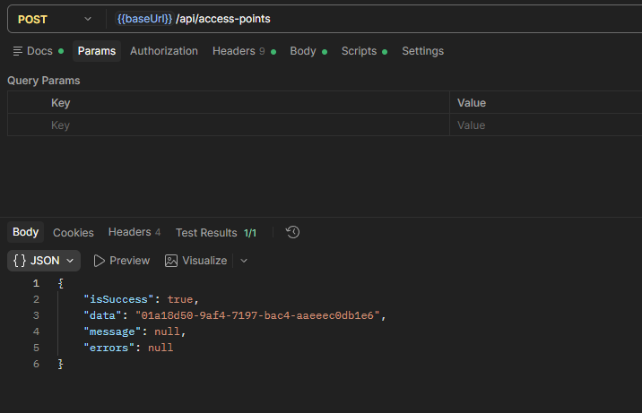 | 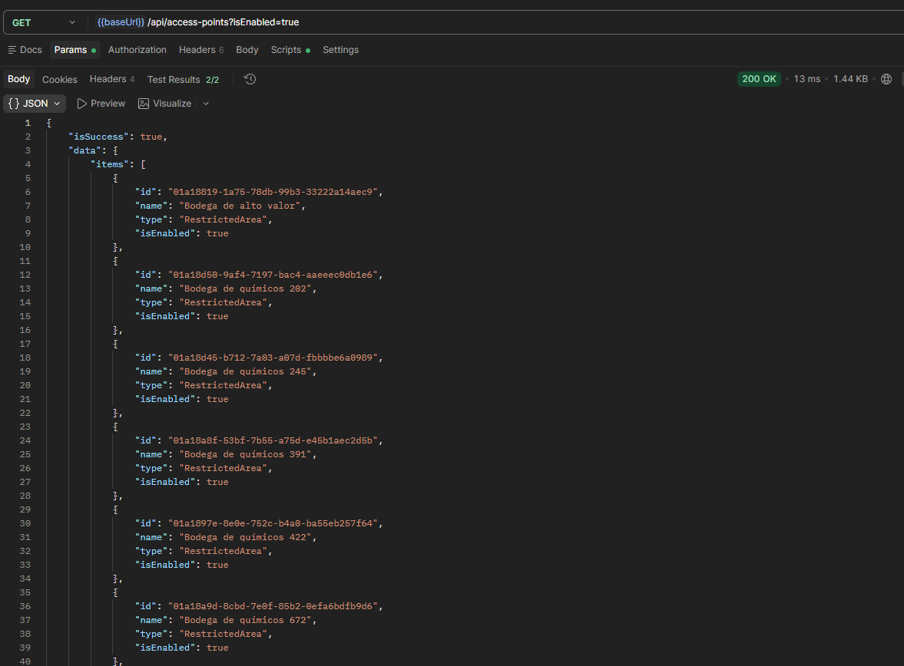 |

### Pruebas unitarias

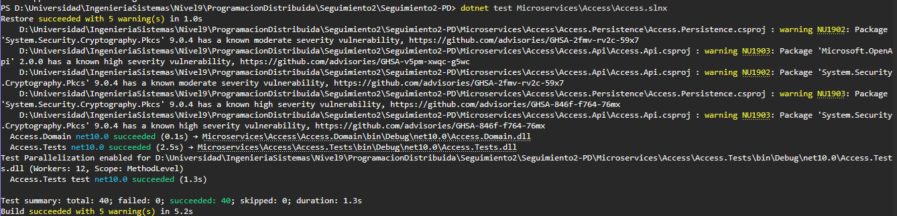

### Base de datos

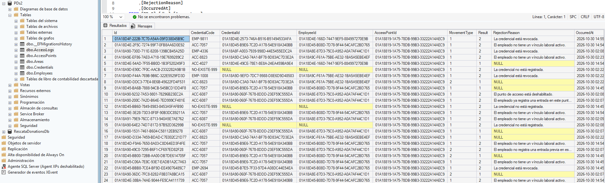
